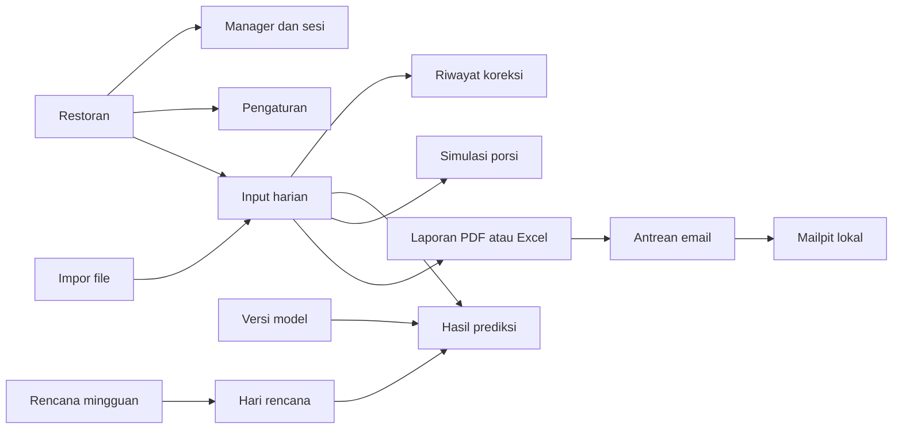

# Panduan menjalankan dan menguji backend FoodSave

Backend menyimpan akun, data operasional, prediksi, simulasi, impor, laporan,
dan riwayat email ke PostgreSQL. Panduan ini menguji alur tersebut sampai ke
isi database, bukan hanya memastikan halaman API terbuka. Frontend dikerjakan
setelah backend ini diperiksa.

## 1. Bentuk sistem yang dijalankan

Satu Docker Compose menjalankan empat layanan:

| Layanan | Fungsi | Akses dari komputer |
|---|---|---|
| `db` | PostgreSQL 16 | `localhost:5433`, database `foodsave` |
| `api` | FastAPI dan model Random Forest | [Swagger](http://localhost:8000/docs) |
| `mailpit` | Menangkap email pengujian | [Kotak masuk lokal](http://localhost:8025) |
| `mail-worker` | Memproses antrean email dan retry | Berjalan di belakang layar |

Semua port host dibatasi ke `127.0.0.1`. Bobot model tetap berupa file di
`models/best_model`, dipasang read-only ke container. Database menyimpan versi,
checksum, metrik, serta hasil prediksi yang merujuk model tersebut.

Volume `postgres_data` menyimpan database, `uploads_data` menyimpan file unggahan
dan laporan, sedangkan `mailpit_data` menyimpan email yang ditangkap. Restart
container tidak menghapus ketiganya.

## 2. Persiapan pertama

Buka PowerShell pada folder proyek. Docker Desktop harus sudah berjalan.

```powershell
cd "C:\Semester5-SDT\FoodSave"
python -m api.init_env
docker-compose config --quiet
docker-compose up -d --build
docker-compose ps
```

`api.init_env` membuat `.env` dengan password database acak jika file belum ada.
Jika `.env` sudah ada, file itu dipertahankan. Jangan menyalin ulang `.env.example`
di atas `.env` yang sedang dipakai karena password volume PostgreSQL sudah
ditentukan saat pertama kali database dibuat. Kredensial tidak masuk Git.

Contoh hasil yang benar:

- `db`: `healthy`.
- `api`: `healthy`.
- `mailpit`: `healthy`.
- `mail-worker`: `running` / `Up`.

Perintah `docker-compose` dipakai karena tersedia pada komputer ini. Pada
instalasi Docker lain, perintah setara dapat berupa `docker compose`.

Untuk menghentikan layanan tanpa menghapus data:

```powershell
docker-compose down
```

Hindari `down -v` jika ingin menyimpan database, unggahan, dan email pengujian.
Untuk menjalankan kembali cukup `docker-compose up -d`.

## 3. Uji health API sebelum menguji menu

```powershell
Invoke-RestMethod http://localhost:8000/health/live
Invoke-RestMethod http://localhost:8000/health/ready
Invoke-RestMethod http://localhost:8000/health
```

| Endpoint | Arti | Hasil normal |
|---|---|---|
| `/health/live` | Proses API hidup | HTTP 200, `status: alive` |
| `/health/ready` | DB tersambung, migrasi sesuai, model/preprocessing dapat dimuat dan fiturnya cocok | HTTP 200, `status: ready` |
| `/health` | Alias readiness | Sama dengan `/health/ready` |

Readiness mengembalikan HTTP 503 jika database/migrasi/model belum siap. Liveness
bisa tetap 200 saat database terputus; itu bukan berarti penyimpanan sudah siap.
Revision saat implementasi ini adalah `0005_insight_creator`.

Log untuk mencari penyebab:

```powershell
docker-compose logs --tail 100 api db mail-worker mailpit
docker-compose exec api python -m alembic current
docker-compose exec api python -m alembic check
```

`alembic check` seharusnya menampilkan `No new upgrade operations detected`.
Perubahan CHECK constraint harus ditulis eksplisit dalam migrasi karena tidak
seluruh jenis perubahan constraint terdeteksi otomatis oleh Alembic.

## 4. Uji otomatis seluruh backend

Tes memakai PostgreSQL sungguhan pada `foodsave_test`, bukan SQLite. Data setiap
kasus tes di-rollback; tes tidak memakai tabel produksi untuk menyimpan data uji.

```powershell
.\.venv\Scripts\python.exe -m pip install -r requirements-test.txt
.\.venv\Scripts\python.exe -m api.test_backend --prepare
```

Jika `.venv` belum tersedia:

```powershell
python -m venv .venv
.\.venv\Scripts\python.exe -m pip install -r requirements-test.txt
```

`--prepare` membuat database dengan akhiran `_test` jika belum ada. Pengguna DB
perlu izin CREATE DATABASE untuk langkah pertama ini. Pada PostgreSQL Docker
FoodSave lokal izin tersebut tersedia. Untuk mengulang tes:

```powershell
.\.venv\Scripts\python.exe -m api.test_backend
```

Jangan menjalankan pytest langsung dengan URL database utama. Fixture menolak
nama database yang tidak diakhiri `_test`. Migrasi juga diuji agar aman dijalankan
ulang. Seluruh test case ada di `api/tests/`.

### Apa yang diperiksa oleh tes

| Kelompok | Pemeriksaan |
|---|---|
| Health | Koneksi DB, revision migrasi, model aktif, 503 ketika layanan tidak siap |
| Akun | Register/login/logout, hash password, cookie HttpOnly, pencabutan sesi, akun nonaktif |
| Hak akses | Staff tidak dapat menulis data manager; restoran lain menerima 404 |
| Pengaturan | Batas risiko berurutan dan kapasitas porsi |
| Input harian | Simpan ke PostgreSQL, tanggal unik, input tidak valid, optimistic version |
| Koreksi | Nilai lama/baru dan manager yang mengubah tercatat |
| Model | Katalog delapan eksperimen, satu model aktif, input target tidak bocor ke prediksi |
| Prediksi | Model nyata dipanggil; hasil, interval, versi dan snapshot tersimpan |
| Mingguan | Tujuh tanggal berurutan, revisi dan riwayat prediksi |
| Simulasi | Porsi dihitung ulang; penerapan idempotent; skenario kedaluwarsa ditolak |
| Transaksi | Kegagalan prediksi membatalkan seluruh perubahan terkait |
| Unggahan | CSV/XLSX, jumlah valid/invalid, dry run, penyimpanan file |
| Laporan | Agregat aktual benar, nilai kosong bukan nol, isi Excel dan file PDF nyata |
| File Excel | Catatan pengguna tidak menjadi formula aktif |
| Email | Outbox, lampiran, Message-ID, retry, kegagalan dan riwayat setiap usaha |
| Batas Mailpit | SMTP luar tidak dapat dipakai dalam mode uji ini |
| SQL | FK lintas restoran, hanya satu model aktif, status laporan konsisten |

Tes email otomatis memakai pengganti pengiriman SMTP agar dapat memeriksa
kegagalan secara sengaja. Pengiriman ke Mailpit sungguhan diuji pada langkah 5.
Warning deprecation dari library boleh muncul; patokan keberhasilan adalah
seluruh tes berstatus `passed`, tanpa `failed` atau `error`.

## 5. Uji HTTP lengkap pada container yang sedang berjalan

```powershell
.\.venv\Scripts\python.exe -m api.smoke_backend
```

Script membuat **restoran DEMO tersendiri**, memakai akun acak, lalu memeriksa:

1. Health dan penolakan akses sebelum login.
2. Pendaftaran manager dan sesi login.
3. Pengaturan harga bahan dan batas risiko.
4. Penyimpanan satu input harian dengan aktual 12,5 kg.
5. Prediksi dari model nyata.
6. Simulasi pengurangan 10% dari 400 menjadi 360 porsi.
7. Penerapan skenario, kenaikan version, dan idempotensi penerapan ulang.
8. Penolakan tanggal duplikat dan permintaan yang memakai version lama.
9. Tujuh hari rencana dengan prediksi per hari.
10. Impor CSV: satu baris valid diterapkan dan satu baris invalid ditolak.
11. Agregat aktual dari database.
12. Unduhan PDF dan XLSX yang benar-benar memiliki isi file sesuai format.
13. Dua email laporan diterima Mailpit, masing-masing dengan satu lampiran.
14. Tugas harian, status insight, notifikasi dibaca, dan overview terbaru.
15. Logout dan penolakan sesi yang sudah dicabut.

Hasil tersimpan lokal pada `results/backend/backend-test-report.json`. Password/token
demo tidak dicetak atau disimpan di laporan tersebut. Setiap run membuat data
DEMO baru dan tidak menghapus data restoran yang sudah ada. Jumlah langkah HTTP
bisa berbeda sedikit karena script menunggu worker menyelesaikan email.

Jika API atau Mailpit memakai port berbeda:

```powershell
.\.venv\Scripts\python.exe -m api.smoke_backend --url http://localhost:8000 --mailpit-url http://localhost:8025
```

## 6. Uji manual melalui Swagger

Buka [http://localhost:8000/docs](http://localhost:8000/docs).
Untuk setiap endpoint, klik **Try it out**, isi parameter/body, lalu **Execute**.

### 6.1 Membuat akun dan masuk

POST `/api/v1/auth/register`:

```json
{
  "name": "Manager FoodSave",
  "email": "manager-anda@example.test",
  "password": "GantiDenganPasswordAnda2026!",
  "restaurant_name": "Restoran Pengujian Anda"
}
```

Harus HTTP 201, memiliki `id`, `restaurant_id`, dan `role: owner`. Password
tidak boleh muncul pada respons. Browser menyimpan cookie HttpOnly secara
otomatis. GET `/api/v1/auth/me` harus mengembalikan akun yang sama.

Untuk login ulang gunakan POST `/api/v1/auth/login` dengan email/password.
Gunakan email baru jika menerima HTTP 409 karena email sudah terdaftar.
Pemilik restoran dapat membuat manager/staff melalui POST `/api/v1/auth/users`.

### 6.2 Mengatur restoran

GET `/api/v1/settings` untuk melihat nilai saat ini. PUT endpoint yang sama
dengan seluruh field input berikut:

```json
{
  "ingredient_cost_per_kg": 50000,
  "safe_max_kg": 35,
  "warning_max_kg": 47,
  "max_portions": 5000,
  "reduction_target_percent": 10,
  "high_risk_notifications": true,
  "report_recipient_email": "manager-anda@example.test"
}
```

Aman berarti prediksi sampai 35 kg, Waspada di atas 35 sampai 47 kg, dan Tinggi
di atas 47 kg. Dua batas atas cukup untuk membentuk tiga tingkat tersebut.
Biaya awal adalah nol sampai harga bahan diisi. Nama restoran dapat diubah lewat
PUT `/api/v1/restaurant` dengan `{"name":"Nama restoran"}`.

### 6.3 Menyimpan input harian

POST `/api/v1/daily-operations`:

```json
{
  "operation_date": "2026-11-11",
  "meals_prepared": 400,
  "kitchen_staff": 12,
  "staff_experience": "intermediate",
  "special_event": false,
  "event_type": null,
  "temperature_c": 28,
  "humidity_percent": 65,
  "previous_waste_kg": 20,
  "waste_category": "vegetables",
  "actual_waste_kg": null,
  "manager_notes": "Contoh rencana operasional untuk pengujian."
}
```

Simpan `id` dan `version` dari respons. Pengalaman staf: Pemula = `beginner`,
Menengah = `intermediate`, Ahli = `expert`. Jumlah staf harus lebih dari nol.
Jenis acara hanya diisi ketika `special_event: true`. Aktual yang belum ditimbang
diisi `null`, bukan 0.

GET `/api/v1/daily-operations/{id}` harus mengembalikan nilai yang sama.
POST tanggal yang sama pada restoran yang sama harus ditolak dengan HTTP 409.

### 6.4 Mencatat aktual atau memperbaiki data

PUT `/api/v1/daily-operations/{id}` dengan seluruh input harian, ditambah:

```json
{
  "expected_version": 1,
  "correction_reason": "Penimbangan limbah aktual sudah selesai."
}
```

Gabungkan dua field di atas ke body lengkap langkah 6.3, lalu misalnya ubah
`actual_waste_kg` menjadi 12.5. Pakai version terbaru dari GET, bukan selalu 1.
Respons harus memiliki version yang bertambah. GET
`/api/v1/daily-operations/{id}/corrections` menampilkan nilai sebelum/sesudah.
Jika memakai version lama, HTTP 409 mencegah pekerjaan manager lain tertimpa.

### 6.5 Menjalankan prediksi

POST `/api/v1/daily-operations/{id}/predict`, tanpa body. Harus HTTP 201 dan
berisi `model_version_id`, prediksi kg, interval, `risk_level`, biaya estimasi,
`operation_version`, serta `input_snapshot` dan `settings_snapshot`.

GET `/api/v1/predictions?daily_operation_id={id}` menampilkan riwayatnya.
Perubahan input tidak menimpa snapshot prediksi lama. Setelah input berubah,
overview tidak menampilkan prediksi lama sebagai prediksi rencana terbaru.
Jalankan prediksi ulang untuk version yang baru.

### 6.6 Menjalankan dan menerapkan simulasi

POST `/api/v1/portion-scenarios`:

```json
{
  "daily_operation_id": "GANTI_DENGAN_ID_INPUT_HARIAN",
  "reduction_percent": 10,
  "kitchen_staff": 12,
  "application_date": "2026-11-11",
  "notes": "Uji pengurangan porsi sebelum diterapkan.",
  "status": "saved"
}
```

Tanggal penerapan harus sama dengan tanggal input terkait. Pilihan pengurangan
adalah 0, 5, 10, atau 15 persen. Untuk 400 porsi dan 10%, hasilnya 360 porsi.
Penghematan bisa negatif jika estimasi model justru lebih buruk. Risiko kehabisan
makanan disimpan `unknown` karena belum ada data permintaan pelanggan.

POST `/api/v1/portion-scenarios/{scenario_id}/apply`:

```json
{"expected_operation_version": 1}
```

Ganti 1 dengan version input terbaru. Porsi/staf diperbarui, koreksi dicatat,
dan prediksi baru disimpan dalam satu transaksi. Penerapan ulang skenario yang
sudah diterapkan tidak mengurangi porsi lagi. Jika input/model berubah setelah
simulasi dibuat, buat simulasi baru.

### 6.7 Prediksi tujuh hari

POST `/api/v1/weekly-predictions` memakai JSON contoh di
`api/examples/weekly_prediction.json`. Semua tujuh tanggal harus berbeda dan
berurutan mulai dari `starts_on`. Setiap hari memiliki input dan hasil prediksi.

GET `/api/v1/weekly-predictions/{id}` untuk detail. PUT
`/api/v1/weekly-predictions/{id}/days/{day_id}` memakai input harian lengkap,
`expected_version`, dan `correction_reason`. Tanggal hari tersebut tetap.
GET `/api/v1/weekly-predictions/{id}/revisions` untuk riwayat perubahan.
Tujuh hari ini dihitung dari input rencana per hari, bukan meramal input
operasional yang belum diketahui.

### 6.8 CSV dan Excel

POST `/api/v1/imports` melalui Swagger dengan file
`api/examples/daily_operations.csv` dan `apply: false`. Contoh berisi dua baris
valid dan satu baris staf nol yang sengaja invalid. Periksa `valid_rows`,
`invalid_rows`, `unusual_rows`, dan `validation_results`.

Untuk menerapkan baris valid, unggah dengan `apply: true`. Baris invalid tidak
masuk `daily_operations`, dan tanggal yang sudah ada tidak ditimpa. File modern
Excel `.xlsx` juga didukung. Maksimal 5 MB/10.000 baris, CSV memakai UTF-8 dan
pemisah koma. GET `/api/v1/imports` menampilkan riwayat; file asli dapat diunduh
melalui `/api/v1/imports/{id}/file` setelah login.

### 6.9 Laporan, unduhan, dan Mailpit

GET `/api/v1/reports/summary?starts_on=2026-11-01&ends_on=2026-11-30`.
Total aktual berasal dari `daily_operations`; aktual kosong dihitung terpisah.
Estimasi biaya memakai harga bahan saat laporan diminta, bukan biaya historis
akuntansi.

POST `/api/v1/report-exports`:

```json
{
  "starts_on": "2026-11-01",
  "ends_on": "2026-11-30",
  "period_type": "monthly",
  "file_format": "pdf",
  "email_recipient": "manager-anda@example.test",
  "email_subject": "Laporan pengujian FoodSave",
  "email_message": "Mohon tinjau laporan pada lampiran."
}
```

Untuk Excel ganti `file_format` menjadi `xlsx`. File yang berhasil dibuat
memiliki `generation_status: ready`. Unduh lewat
`/api/v1/report-exports/{id}/file`; `downloaded_at` akan dicatat.

Email yang diminta masuk antrean `pending`, diproses worker, lalu menjadi `sent`
setelah diterima **Mailpit lokal**. Buka [http://localhost:8025](http://localhost:8025)
dan periksa penerima, subjek, isi, serta lampiran. Tidak ada penerusan ke Gmail,
Outlook, atau internet. Pengiriman di kode ini menolak host SMTP eksternal.

GET `/api/v1/report-exports/{id}/email` menampilkan antrean dan setiap usaha
pengiriman. Jika gagal, retry otomatis maksimal tiga kali, dengan jeda awal
60 detik yang bertambah. POST `/api/v1/report-exports/{id}/email/retry` menjadwalkan
ulang; email yang sudah `sent` tidak dikirim ulang oleh endpoint ini.

`sent` berarti SMTP Mailpit menerima pesan, bukan bukti pengiriman ke kotak
masuk email sungguhan. Jika worker berhenti setelah SMTP menerima tetapi sebelum
database mencatat, percobaan ulang dapat menghasilkan duplikat; Message-ID tetap
dipakai agar percobaan dapat ditelusuri. Worker tidak menjanjikan exactly-once.

### 6.10 Overview, tugas, insight, dan notifikasi

- GET `/api/v1/overview?on=2026-11-11` untuk input/prediksi terbaru, tugas,
  skenario diterapkan, jumlah notifikasi belum dibaca, dan target pengurangan.
- POST `/api/v1/daily-tasks` dengan `task_date` dan `title`; PATCH
  `/api/v1/daily-tasks/{id}` dengan `{"completed":true}`.
- POST `/api/v1/insights` dengan `title`, `suggested_action`, dan prioritas;
  PATCH `/api/v1/insights/{id}` dengan `{"status":"reviewed"}` atau `applied`.
  Status insight adalah catatan manager, bukan perubahan otomatis pada input.
- GET `/api/v1/notifications`; PATCH `/api/v1/notifications/{id}/read` untuk
  menandainya sudah dibaca.

## 7. Cek isi PostgreSQL

Untuk menjalankan kumpulan query yang hanya membaca data:

```powershell
Get-Content api/verify_data.sql | docker-compose exec -T db psql -U foodsave -d foodsave
```

Atau buka psql interaktif:

```powershell
docker-compose exec db psql -U foodsave -d foodsave
```

Perintah SQL utama:

```sql
SELECT version_num FROM alembic_version;
SELECT name, email, role, restaurant_id FROM users;
SELECT name, preprocessing, is_active FROM model_versions;
SELECT operation_date, meals_prepared, actual_waste_kg, version FROM daily_operations;
SELECT predicted_waste_kg, model_version_id, input_snapshot FROM prediction_results;
SELECT baseline_portions, simulated_portions, status FROM portion_scenarios;
SELECT previous_values, new_values, reason FROM data_corrections;
SELECT generation_status, email_status, downloaded_at FROM report_exports;
SELECT status, attempts, sent_at, last_error FROM email_deliveries;
SELECT attempt_number, success, error_message FROM email_attempts;
```

Keluar dari psql dengan `\q`. Ada 19 tabel aplikasi dan tabel `alembic_version`.
Jangan menampilkan kolom `password_hash` atau `token_hash` ke frontend.

## 8. Uji data tetap ada setelah restart

Pemeriksaan otomatis berikut membandingkan snapshot data sebelum/sesudah restart.
Jalankan ketika tidak ada pengguna lain yang mengubah data:

```powershell
.\.venv\Scripts\python.exe -m api.check_persistence
```

Script hanya merestart service `db`, tidak menghapus volume. Hasil lokal berada
di `results/backend/backend-persistence-check.json`.

Catat jumlah atau ID input setelah smoke test, lalu:

```powershell
docker-compose restart db
docker-compose ps
Invoke-RestMethod http://localhost:8000/health/ready
Get-Content api/verify_data.sql | docker-compose exec -T db psql -U foodsave -d foodsave
```

Tunggu DB kembali healthy bila readiness sementara 503. ID dan isi input harus
tetap sama. Koneksi API memakai pool pre-ping agar dapat tersambung kembali.

## 9. Cek model secara khusus

Panduan rinci ada pada [MODEL_VALIDATION.md](MODEL_VALIDATION.md).

```powershell
.\.venv\Scripts\python.exe -m api.check_model --database
docker-compose exec api python -m api.check_model --database
```

Perintah lokal juga menghitung ulang 174 baris test jika dataset mentah dan CSV
referensi tersedia. Container hanya memuat kebutuhan inferensi; dataset mentah
tidak dimasukkan ke image, sehingga pemeriksaan holdout di container bisa
berstatus `not_available`. Pemeriksaan artefak, fitur, dan DB tetap dijalankan.

## 10. Ringkasan tabel dan relasi

| Tabel | Isi utama |
|---|---|
| `restaurants`, `restaurant_settings` | Identitas restoran, harga, batas risiko, kapasitas, target |
| `users`, `user_sessions` | Manager/staff, hash password, preferensi, sesi yang dapat dicabut |
| `daily_operations`, `data_corrections` | Input harian dan jejak perubahan |
| `data_imports` | Metadata file, pemeriksaan, dan jumlah baris diterapkan |
| `model_versions` | Metadata delapan eksperimen dan model yang aktif |
| `prediction_results` | Hasil model, interval, snapshot input/pengaturan |
| `weekly_predictions`, `prediction_days`, `plan_revisions` | Rencana tujuh hari dan revisinya |
| `portion_scenarios` | Skenario sebelum/sesudah, penghematan, status penerapan |
| `operational_insights`, `daily_tasks`, `notifications` | Insight, checklist, dan notifikasi |
| `report_exports` | Filter, lokasi file, unduhan, dan informasi email |
| `email_deliveries`, `email_attempts` | Outbox dan riwayat percobaan pengiriman |



API menyaring data berdasarkan restoran akun yang sedang login. Foreign key
komposit juga mencegah relasi/actor merujuk restoran lain. Angka agregat laporan
tidak disalin menjadi tabel ringkasan permanen. File ekspor merupakan snapshot
data pada waktu file dibuat.

## 11. Penanganan masalah umum

| Gejala | Langkah pemeriksaan |
|---|---|
| Port 8000/5433/8025 dipakai | Periksa container/aplikasi lain; sesuaikan port Compose dan origin yang diizinkan |
| Readiness 503 | Lihat log DB/API, migration current, manifest model dan file mount |
| Login 401 | Periksa email/password, akun aktif, cookie, atau login kembali |
| Tanggal ditolak 409 | Gunakan PUT pada ID yang sudah ada; jangan POST duplikat |
| Version ditolak 409 | GET ulang, gunakan version terbaru, atau buat ulang skenario |
| Role ditolak 403 | Gunakan akun owner/manager untuk operasi tulis |
| CSV valid_rows nol | Baca validation_results; cek nama kolom, staf, tanggal dan tipe angka |
| Email tetap pending | Pastikan mail-worker running, Mailpit healthy, dan file laporan tersedia |
| Email failed | Baca riwayat attempt, perbaiki layanan lalu gunakan retry |
| Belum ada model aktif | Jalankan `docker-compose exec api python -m api.seed_model` |
| Dataset mentah tidak ada | Letakkan train.csv asli di dataset/raw untuk cek ulang holdout lokal |

Jangan melakukan reset volume atau menghapus database untuk memperbaiki error
input. Perbaiki input/migrasi yang relevan agar riwayat tetap tersimpan.

Rujukan teknis: [Docker Compose health dependencies](https://docs.docker.com/compose/how-tos/startup-order/),
[SQLAlchemy PostgreSQL](https://docs.sqlalchemy.org/en/20/dialects/postgresql.html),
[Mailpit Docker](https://mailpit.axllent.org/docs/install/docker/),
[Mailpit API](https://mailpit.axllent.org/docs/api-v1/).
